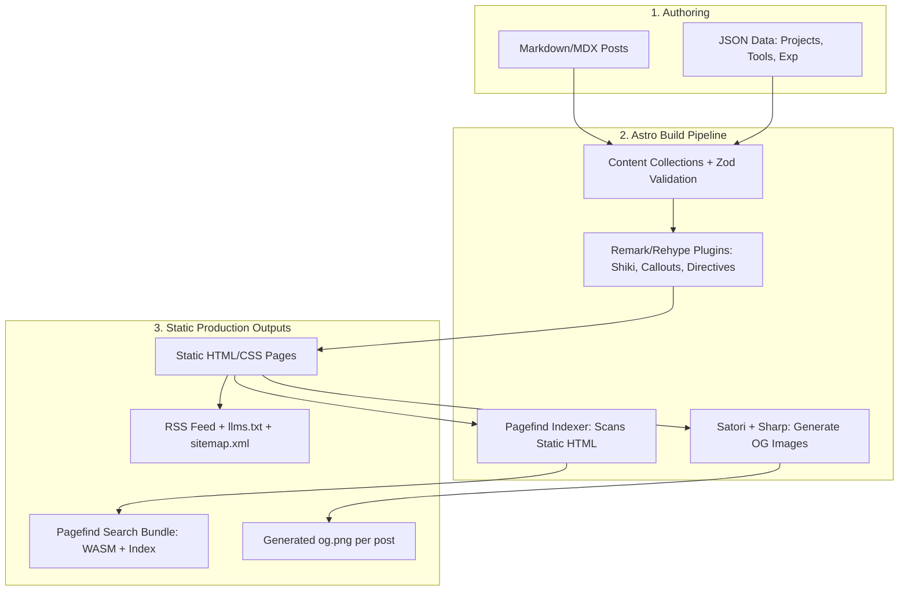

# Product Requirement Document (PRD): Modern Personal Developer Platform

**Project Code**: `dev-platform` (Versi Reverse Engineering dari *Pictogrammer / Astron*)  
**Target Eksekusi**: Sprint Malam Ini (MVP Core) & Tahap Lanjutan  
**Status**: Ready for Implementation  

---

## 1. Executive Summary & Vision

Platform ini adalah website personal portfolio sekaligus blog teknikal kelas tinggi (high-craft engineering) untuk developer. Berbeda dari blog personal biasa, platform ini mengadopsi prinsip:
1. **Zero-JS by Default**: Menggunakan Astro SSG (Static Site Generation), hanya memuat JavaScript interaktif pada komponen yang benar-benar membutuhkan (pulau interaktivitas / Astro Islands).
2. **Content as Code**: Seluruh konten (artikel, project showcase, work experience, buku bacaan, stack tools) disimpan dalam bentuk Markdown (`.md`/`.mdx`) dan JSON terstruktur yang divalidasi oleh Zod Schema (Astro Content Collections).
3. **AI & Agent Ready (AEO - Answer Engine Optimization)**: Memiliki endpoint khusus `llms.txt`, `llms-full.txt`, dan `WebMCP` sehingga agen AI (ChatGPT, Claude, Gemini, IDE AI) dapat membaca konten dan kapabilitas website secara terstruktur.
4. **Editorial & High-Aesthetic Typography**: Desain minimalis berbasis warm paper monochrome & accent earthy color (seperti Flexoki), typography presisi (Geist Sans, Geist Mono, Merriweather), serta dark mode tanpa kedipan (*flash of unstyled theme*).

---

## 2. Core Architecture & Tech Stack

| Layer | Pilihan Teknologi | Alasan Pemilihan |
|---|---|---|
| **Runtime & Package Manager** | Bun / Node.js (v20+) | Build super cepat dan manajemen dependency modern. |
| **Framework** | Astro 5+ / 7 | Framework SSG terbaik untuk website berbasis konten. |
| **Styling** | Tailwind CSS v4 + PostCSS/Vite plugin | CSS token-driven, utility-first, performa build instan. |
| **Content Engine** | Astro Content Collections + Zod | Type-safe data schema, autocompletion di IDE. |
| **Fulltext Search** | Pagefind (`astro-pagefind`) | Client-side search instan tanpa perlu database eksternal (Algolia dsb). Dibuat saat build time. |
| **Markdown Pipeline** | Unified / Remark / Rehype | Syntax highlighting (Shiki), callouts/admonitions, custom embeds. |
| **Dynamic OG Image** | Satori + Sharp | Otomatis membuat banner OpenGraph (PNG) berbasis HTML/SVG saat build untuk tiap artikel. |
| **AI Integration** | `llms.txt` + WebMCP tools | AI-first web integration standar baru. |
| **Deployment Target** | Cloudflare Pages / Vercel / GitHub Pages | Hosting statis edge cepat dengan biaya Rp 0. |

---

## 3. Struktur Repository & Mapping Direktori

```
pictogrammer-clone/
├── content/                     # DATA & KONTEN (Single Source of Truth)
│   ├── post/                    # Artikel Markdown/MDX (subfolder per topik/tahun)
│   ├── series/                  # Seri artikel (JSON)
│   ├── projects/                # Daftar project portfolio (JSON)
│   ├── experiences/             # Riwayat karir & edukasi (JSON)
│   ├── tools/                   # Stack hardware & software (JSON)
│   └── reading/                 # Buku/artikel bacaan (JSON)
├── public/                      # Static assets (favicon, avatar, fonts lokal, robots)
├── src/
│   ├── assets/                  # CSS tokens, style global, gambar internal
│   │   ├── styles/
│   │   │   ├── tokens.css       # Definisi variabel warna, spacing, fonts
│   │   │   └── global.css       # Reset & utilitas global
│   ├── config/                  # Metadata situs (siteUrl, author, navigasi, medsos)
│   ├── components/              # 3-Tier Component Architecture:
│   │   ├── ui/                  # Atomic & Primitives (Button, Badge, Card, Kbd, Dialog)
│   │   ├── shell/               # Layout shell (Header, Footer, BaseHead, ThemeToggle, WebMcp)
│   │   ├── common/              # Shared widget (Seo, JsonLd, PostMetadata, SocialLinks)
│   │   └── features/            # Fitur spesifik (BlogList, ProjectCard, SearchModal, Hero)
│   ├── layouts/                 # BaseLayout.astro, BlogPostLayout.astro
│   ├── lib/                     # Helper & content loaders:
│   │   ├── contents/            # Zod schemas & query helper untuk content collections
│   │   ├── seo/                 # Generator metadata & JSON-LD
│   │   └── webmcp/              # Registrasi browser AI tools
│   ├── pages/                   # File-based Routing:
│   │   ├── index.astro          # Landing page (Hero, Recent Posts, Highlights)
│   │   ├── about.astro          # Bio, Experience timeline, Skills
│   │   ├── blog/
│   │   │   ├── index.astro      # Semua postingan + pagination
│   │   │   ├── [slug].astro     # Halaman baca artikel
│   │   │   └── tags/[tag].astro # Filter artikel by tag
│   │   ├── projects.astro       # Showcases aplikasi/karya
│   │   ├── tools.astro          # "Uses" / Tech stack & equipment
│   │   ├── now.astro            # Derek Sivers "/now" page
│   │   ├── rss.xml.ts           # RSS Feed generator
│   │   ├── llms.txt.ts          # AI crawler documentation feed
│   │   └── og/[slug].png.ts     # Dynamic social banner image generator
│   └── content.config.ts        # Deklarasi koleksi Astro
├── astro.config.ts              # Konfigurasi Astro + Integrations + Remark Plugins
├── package.json
└── tsconfig.json
```

---

## 4. End-to-End Workflow / Lifecycle



1. **Input**: Penulis cukup menambahkan file `.md` di `content/post/` atau mengubah data JSON di `content/projects/`.
2. **Build Time Validation**: Zod schema memastikan setiap properti wajib (title, date, tags, description) tidak ada yang terlewat atau salah tipe data. Jika ada kesalahan, build langsung gagal dengan pesan error jelas.
3. **Markdown Transformation**: Astro merender markdown menjadi HTML semantic, syntax highlighting disuntikkan oleh Shiki (dark-plus), link eksternal ditambahkan rel `noreferrer noopener`.
4. **Search Indexing**: `astro-pagefind` secara otomatis membedah file HTML hasil build dan menyusun indeks pencarian ringan berbasis WASM.
5. **AEO & LLM Feeds**: `src/pages/llms.txt.ts` mengumpulkan seluruh daftar artikel dan ringkasan portofolio menjadi plain text standar untuk dikonsumsi agen LLM.

---

## 5. Fitur Utama & Spesifikasi Fungsional

### F1: Theming & Typography (Dark/Light Mode)
- **Kebutuhan**: Mendukung Light Theme (warm paper `#FFFCF0`), Dark Theme (`#100F0F`), dan sinkronisasi dengan OS `prefers-color-scheme`.
- **Anti-FOUC**: Script inline di `<head>` mengecek `localStorage.theme` atau `prefers-color-scheme` dan langsung menambahkan class `.dark` ke elemen `<html>` sebelum rendering CSS.

### F2: Blog & Editorial Experience
- Mendukung frontmatter artikel:
  - `title`, `description`, `publishedAt`, `updatedAt`, `tags`, `series` (opsional), `draft` (boolean).
- Fitur baca artikel:
  - Estimasi waktu baca (*reading time*).
  - Table of Contents (TOC) otomatis dari heading `#`, `##`, `###`.
  - Code block dengan badge bahasa dan tombol *Copy to Clipboard*.
  - Callouts/Admonitions (`:::note`, `:::tip`, `:::warning`).
  - Next/Previous post navigation.

### F3: Client-Side Instant Search
- Menggunakan `Pagefind`.
- Tombol shortcut keyboard: `Ctrl + K` atau `Cmd + K` untuk membuka modal pencarian.
- Modal pencarian menampilkan judul, cuplikan konten dengan *highlight keyword*, dan navigasi keyboard (Up/Down/Enter/Escape).

### F4: Portfolio Showcases
- Halaman `projects.astro` menampilkan kartu proyek dengan badge teknologi (misal: React, Go, Docker), screenshot, link demo live, dan link repository GitHub.

### F5: Career & "Uses" Pages
- `about.astro`: Timeline pengalaman kerja, riwayat edukasi, dan bio.
- `tools.astro`: Rekomendasi hardware, editor/IDE setup, software produktivitas yang digunakan sehari-hari.
- `now.astro`: Halaman status aktivitas saat ini (buku yang sedang dibaca, topik yang sedang dipelajari, project yang sedang aktif).

### F6: AI-Ready Architecture (AEO)
- `llms.txt`: Rangkuman Markdown terstruktur tentang profil developer, daftar link penting, dan ringkasan artikel.
- `llms-full.txt`: Versi lengkap dump konten artikel yang ramah token untuk AI kontekstual.
- `WebMCP`: Expose tool JavaScript sederhana di browser untuk interoperabilitas agen masa depan.

---

## 6. Action Plan: Sprint Malam Ini (Step-by-Step 0 to 1)

Berikut panduan langkah demi langkah jika ingin mulai membangun malam ini juga:

### Langkah 1: Inisialisasi Proyek Astro
```bash
# Buat folder proyek baru
mkdir my-dev-portfolio && cd my-dev-portfolio

# Inisialisasi Astro minimalis
bun create astro@latest ./ --template minimal --typescript strict --install --no-git
```

### Langkah 2: Install Dependensi Kunci
```bash
bun add @tailwindcss/vite tailwindcss astro-icon astro-pagefind @astrojs/sitemap @astrojs/rss
bun add -D @types/node
```

### Langkah 3: Setup Konfigurasi Tailwind & Font
Konfigurasi `astro.config.ts`:
```ts
import { defineConfig } from "astro/config";
import tailwindcss from "@tailwindcss/vite";
import pagefind from "astro-pagefind";
import sitemap from "@astrojs/sitemap";
import icon from "astro-icon";

export default defineConfig({
  site: "https://domain-kamu.dev",
  integrations: [sitemap(), pagefind(), icon()],
  vite: {
    plugins: [tailwindcss()]
  }
});
```

### Langkah 4: Tentukan Skema Content Collections (`src/content.config.ts`)
```ts
import { defineCollection, z } from "astro:content";
import { glob } from "astro/loaders";

const post = defineCollection({
  loader: glob({ pattern: "**/*.{md,mdx}", base: "./content/post" }),
  schema: z.object({
    title: z.string(),
    description: z.string(),
    publishedAt: z.coerce.date(),
    updatedAt: z.coerce.date().optional(),
    tags: z.array(z.string()).default([]),
    draft: z.boolean().default(false)
  })
});

const projects = defineCollection({
  loader: glob({ pattern: "**/*.json", base: "./content/projects" }),
  schema: z.object({
    title: z.string(),
    description: z.string(),
    url: z.string().url().optional(),
    github: z.string().url().optional(),
    tags: z.array(z.string()),
    featured: z.boolean().default(false)
  })
});

export const collections = { post, projects };
```

### Langkah 5: Buat Core Shell & Layout
1. `src/components/shell/BaseHead.astro` (Meta tags, Google fonts, CSS link, Theme script anti-FOUC).
2. `src/components/shell/Header.astro` & `Footer.astro`.
3. `src/layouts/BaseLayout.astro`.

### Langkah 6: Buat Halaman Utama
1. `src/pages/index.astro`: Hero greeting + ringkasan artikel terbaru.
2. `src/pages/blog/index.astro`: List semua artikel.
3. `src/pages/blog/[...slug].astro`: Halaman render markdown artikel dengan layout prose typography.
4. `src/pages/projects.astro`: List karya project.
5. `src/pages/llms.txt.ts`: Endpoint text untuk AI.

### Langkah 7: Masukkan Dummy / Konten Awal & Test Dev Server
```bash
bun run dev
```

---

## 7. Rencana Pengembangan Bertahap (Roadmap)

- **Fase 1 (Malam Ini - Core MVP)**:
  - Setup Astro + Tailwind 4
  - Dark mode switcher tanpa flicker
  - Content Collections (Post & Projects)
  - Halaman Index, Blog List, Post Reader, Projects
- **Fase 2 (Besok / Weekend - Polish & Search)**:
  - Integrasi Search modal (`astro-pagefind` + `Ctrl+K`)
  - Remark/Rehype custom plugins (callouts, auto slug heading)
  - Halaman About, Uses/Tools, Now
  - RSS Feed (`rss.xml.ts`) & Sitemap
- **Fase 3 (Next Level - AI & Aesthetic Craft)**:
  - Dynamic OpenGraph Generator dengan Satori (`og/[slug].png`)
  - Feed `llms.txt` & WebMCP tool registration
  - CI/CD deployment ke Cloudflare Pages menggunakan Wrangler / GitHub Actions
